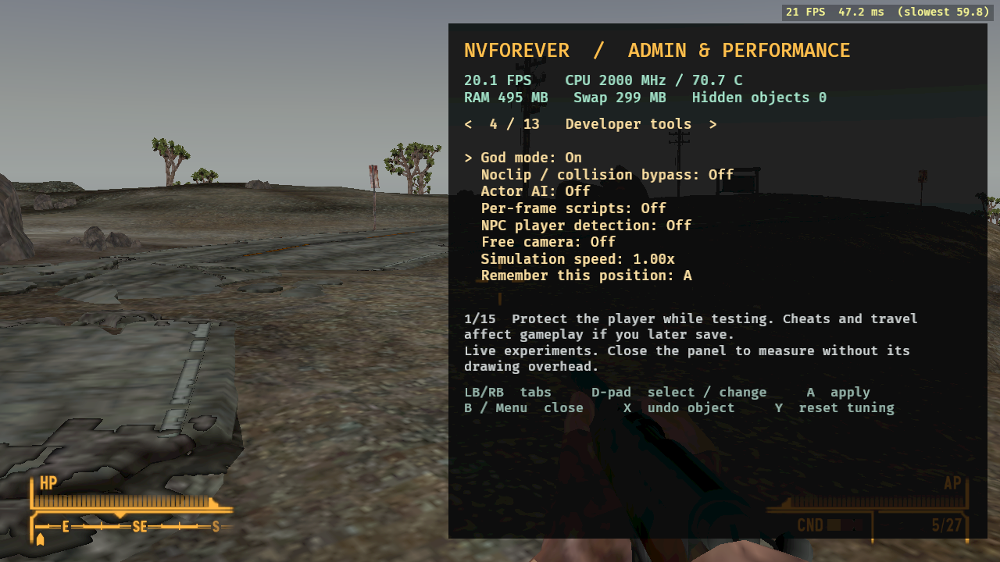
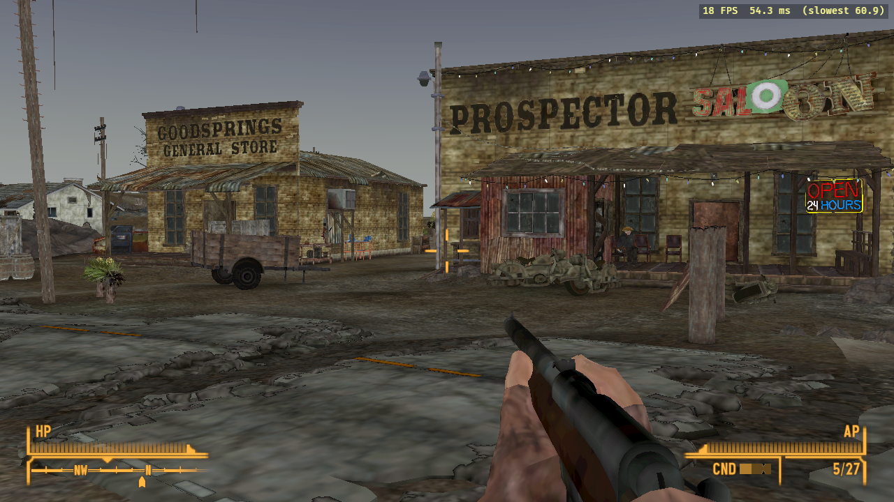

# NVForever for TrimUI Smart Pro

Experimental native ARM64 PortMaster port of [NVForever](https://github.com/LootJunkieAzza/NVForever), an open-source reimplementation of the Fallout: New Vegas engine.

**[Download the PortMaster ZIP](https://github.com/ToastedFrog2/NVForever-TrimUI/releases/latest)**

Requires a **TrimUI Smart Pro**, PortMaster, and the PC game data from your own copy of Fallout: New Vegas. No game data, saves, device credentials or user configuration are included.

## Install

1. Download **nvforever.zip** from Releases. Put the ZIP in `Apps/PortMaster/PortMaster/autoinstall/` on the SD card and open PortMaster. A local/offline installation is also supported.
2. Copy your PC game's complete `Data` folder to `Data/ports/nvforever/game/Data/` on the SD card. `FalloutNV.esm` must be directly inside that folder. Include the archives and Music/Sound folders; DLC is optional.
3. The handheld has 1 GB of RAM. Create the required 2 GB swap file once from an SSH session or terminal:

   ```sh
   sh /mnt/SDCARD/Data/ports/nvforever/setup-swap.sh 2048
   ```

   This needs approximately 2 GB free on internal storage and can take several minutes. The launcher enables the file on subsequent launches.
4. Start **NVForever** from the Ports list. Shader compilation can make the first launch slow.

Updates preserve `nvforever/home/` (saves/settings), `nvforever/game/` and the swap file. Back up important saves before updating.

## Controls

| Control | Action |
| --- | --- |
| A / B | Confirm / cancel |
| Start | Pause menu |
| Menu + Start, held for one second | Exit to the handheld menu |
| Menu, when the developer menu is enabled | Open or close the developer panel |

## Optional developer menu

The release defaults to **disabled**. To enable it, create `Data/ports/nvforever/home/dev-menu.ini` on the SD card:

```ini
[DeveloperMenu]
Enabled=1
```

Set `Enabled=0` to disable it. Restart the game after changing the file. The personal configuration folder survives updates; the package does not ship that folder.

The panel offers render visibility/detail controls, an object browser with hide/undo, gameplay testing tools and game settings. Use LB/RB for tabs, D-pad to select/change, A to apply, B/Menu to close, X to undo an object hide and Y to reset tuning. Rendering hides do not remove collision or quest references. Gameplay cheats, inventory, time and travel changes may enter a later save. Close the panel when measuring performance.

## Screenshots

The optional developer menu is enabled in the first image for demonstration; the download defaults it off.





## Version 0.3

- Skips unchanged UI layout/stack work and unchanged developer-panel text writes.
- Resolves clock-global identifiers once and reuses placement lookups during enable-parent checks.
- Uses active lists for package-timer and concussion maintenance, rebuilt when saves load.
- Skips idle object-animation lookup tables, backported from upstream.
- Adds optional Vulkan API wall/CPU timing, fault/I/O telemetry and p99 frame-time logging.

This is an experimental port. Performance depends on the scene, cache warm-up, settings and temperature. Matched before/after FPS gains have not been established. Some gameplay systems remain incomplete upstream. See [release notes](CHANGELOG.md), [performance notes](trimui/FPS-WORK.md) and [installation details](trimui/package/README.txt).

## Source, builds and credits

See [BUILDING.md](BUILDING.md) for build instructions and [CONTRIBUTING.md](CONTRIBUTING.md) for contribution rules. Each binary release includes a corresponding source archive.

NVForever is by LootJunkieAzza and the NVForever contributors. This port includes upstream code based on revision `4d6e4bdf6`, with the object-animation lookup portion of `e12c79d31` and the TrimUI changes described above. See [NOTICE.md](NOTICE.md), [LEGAL.md](LEGAL.md) and [LICENSE](LICENSE).

The engine is GPL-3.0-or-later; bundled third-party components retain their own licenses. Screenshots show gameplay using separately owned game data. NVForever is not affiliated with or endorsed by Bethesda Softworks, ZeniMax Media, Microsoft or Obsidian Entertainment.
